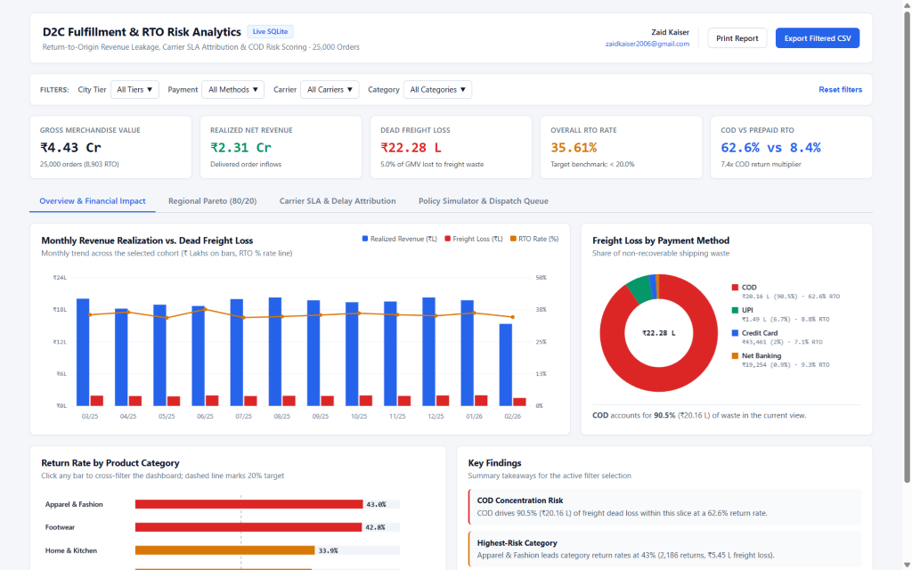
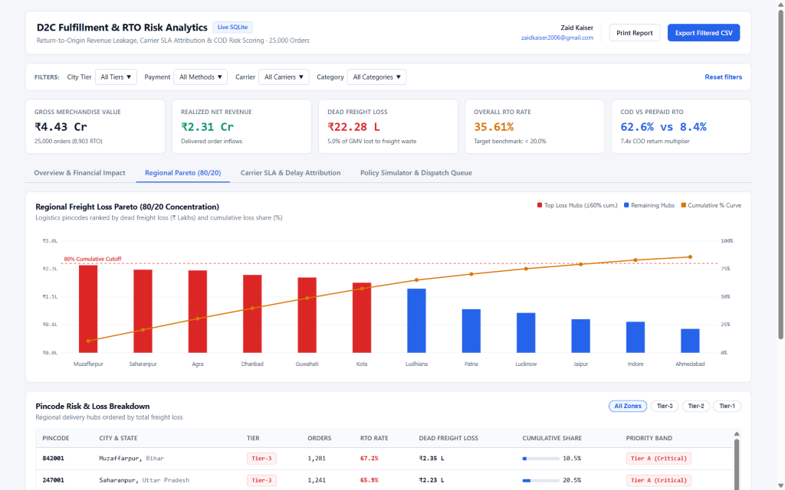
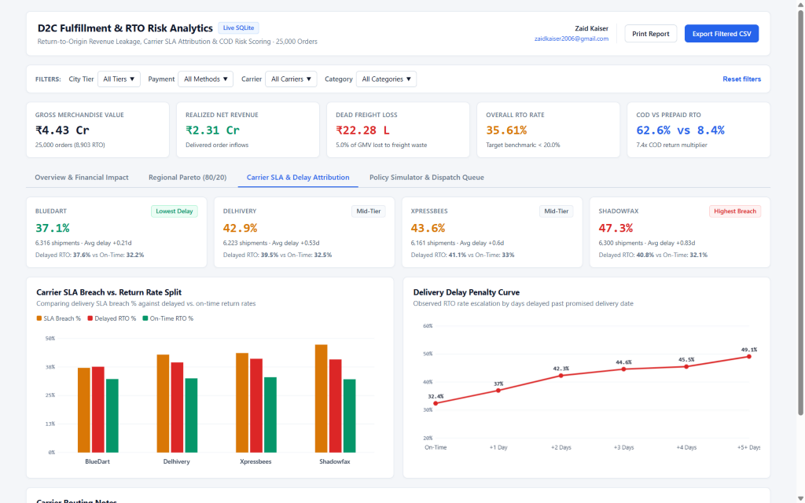
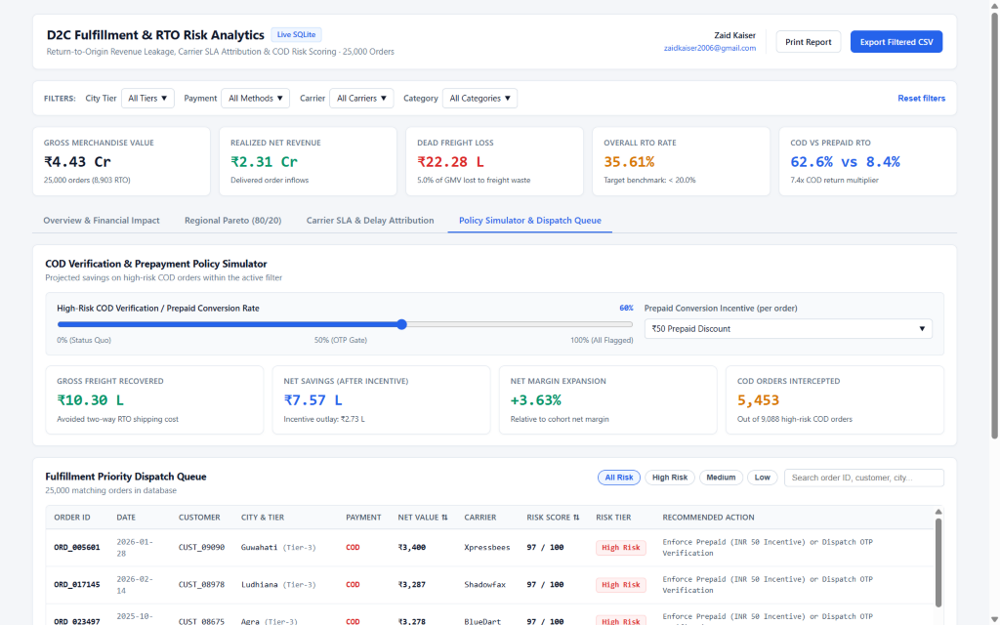

# D2C E-Commerce Logistics & RTO Analytics

**Author:** Zaid Kaiser ([zaidkaiser2006@gmail.com](mailto:zaidkaiser2006@gmail.com))  
**Live Dashboard:** [https://zidk1.github.io/d2c-logistics-rto-analytics/](https://zidk1.github.io/d2c-logistics-rto-analytics/)  
**Stack:** Python 3.12, SQLite / PostgreSQL SQL, Django 5.2, Microsoft Power BI (DAX / TMDL)  
**Benchmark Reference:** Problem framing inspired by [Kaggle: E-Commerce Return Abuse Detection Dataset](https://www.kaggle.com/datasets/sarveshchhetri/e-commerce-return-abuse-detection-dataset/data)

---

## Overview

In Indian D2C e-commerce, **Return-to-Origin (RTO)** on Cash-on-Delivery (COD) shipments erodes contribution margin because unaccepted deliveries incur non-recoverable forward freight, reverse logistics, packaging, and COD handling charges.

This project implements an analytical pipeline and interactive BI dashboard over **25,000 simulated orders** across 20 logistics pincodes:
- Quantifies **INR 22.28 Lakhs** in dead logistics loss out of **INR 4.43 Cr** gross merchandise value (GMV).
- Runs relational SQL analytics (CTEs, window functions, `LAG()`, Pareto running sums) in SQLite.
- Scores incoming orders in real time using chronological customer and pincode return history to isolate **INR 17.17 Lakhs** in preventable COD loss across **9,088 high-risk orders**.

---

## Dashboard Preview

| Overview & Financial Impact | Regional Pareto (80/20) |
| :---: | :---: |
|  |  |

| Carrier SLA & Delay Attribution | Policy Simulator & Dispatch Queue |
| :---: | :---: |
|  |  |

---

## Key Empirical Findings (Verified on `data/d2c_logistics.db`)

1. **COD vs. Prepaid Disparity:**
   - COD accounts for **50.2%** of orders (12,550) yet generates **90.5%** (**INR 20.16 Lakhs**) of all dead freight expenditure.
   - COD RTO rate is **62.58%** versus **8.43%** on prepaid methods (`7.4x` multiplier).

2. **Regional Concentration (Pareto 80/20):**
   - Just **6 Tier-3 pincodes** (Muzaffarpur, Saharanpur, Agra, Dhanbad, Guwahati, Kota) drive **57.4%** (**INR 12.78 Lakhs**) of total shipping waste.
   - The **top 10 pincodes** account for **79.2%** (**INR 17.66 Lakhs**) of total freight loss.

3. **Delivery SLA Delay Escalation:**
   - On-time deliveries return at **32.45%**, increasing to **37.45%** for 1–2 days late and **47.03%** when delayed 3+ days beyond SLA.
   - Across carriers, SLA breach rates range from **37.1%** (BlueDart) to **47.3%** (Shadowfax).

4. **Category Sensitivity:**
   - Apparel & Fashion (**43.0%**) and Footwear (**42.8%**) show the highest return propensity compared to Beauty & Personal Care (**25.1%**).

---

## Project Structure

```text
.
├── analytics_portal/                    # Django REST API querying SQLite live
│   ├── queries.py                       # Parameterized SQL aggregations & window functions
│   ├── views.py                         # Summary API, paginated queue, CSV export
│   └── settings.py / urls.py / wsgi.py
├── data/
│   ├── raw_orders.csv                   # 25,000 generated order transactions
│   ├── customers.csv                    # 10,000 customer profiles
│   ├── pincode_master.csv               # 20 logistics zones & city tiers
│   ├── rto_scored_orders.csv            # Enriched orders with risk scores & actions
│   └── d2c_logistics.db                 # SQLite analytical database
├── sql/
│   ├── 01_schema_setup.sql              # Normalized schema & indexes
│   └── 02_business_analytics.sql        # 7 analytical SQL queries
├── scripts/
│   ├── 01_generate_dataset.py           # Order & logistics simulation
│   ├── 02_rto_risk_engine.py            # Order risk scoring & savings estimate
│   ├── 03_run_sql_analytics.py          # SQLite loader & CLI analytical runner
│   └── 04_sync_dashboard.py             # Syncs SQLite summary cube into index.html
├── dashboard/
│   ├── power_bi_model.tmdl              # TMDL script (17 DAX measures + What-If table)
│   ├── power_bi_corporate_theme.json    # Importable Power BI corporate light theme
│   └── Power_BI_Implementation_Guide.md # Power BI Desktop model & visual checklist
├── screenshots/                         # Dashboard previews & MP4 walkthrough
├── index.html                           # Unified dashboard (works offline & via live server)
└── run_pipeline.py                      # Pipeline runner & local server (`--serve`)
```

---

## How to Run

### 1. View Dashboard Directly (No Server Required)
Open **`index.html`** in Chrome or Edge. Metrics and charts run on pre-aggregated SQLite slices embedded by `scripts/04_sync_dashboard.py`.

### 2. Run Live SQLite Server (Django)
```bash
python run_pipeline.py --serve
```
Opens `http://127.0.0.1:8000/`. All filters, Pareto rankings, What-If projections, and paginated dispatch queries run directly against `data/d2c_logistics.db`.

### 3. Rebuild Full Data & SQL Pipeline
```bash
python run_pipeline.py
```

### 4. Power BI Desktop Build (`.pbix`)
1. Open **Power BI Desktop** -> **Get Data -> Text/CSV** -> load `data/rto_scored_orders.csv`.
2. Go to **Design -> Themes -> Browse for themes** -> select `dashboard/power_bi_corporate_theme.json`.
3. Open **TMDL view** on the left rail -> paste `dashboard/power_bi_model.tmdl` -> click **Apply**.
4. Build the 4 pages described in `dashboard/Power_BI_Implementation_Guide.md` and save as `.pbix`.
